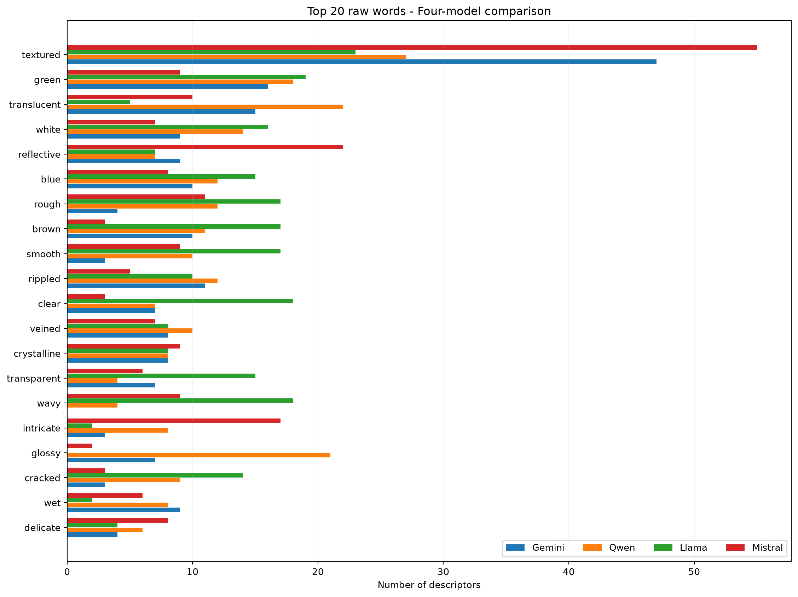
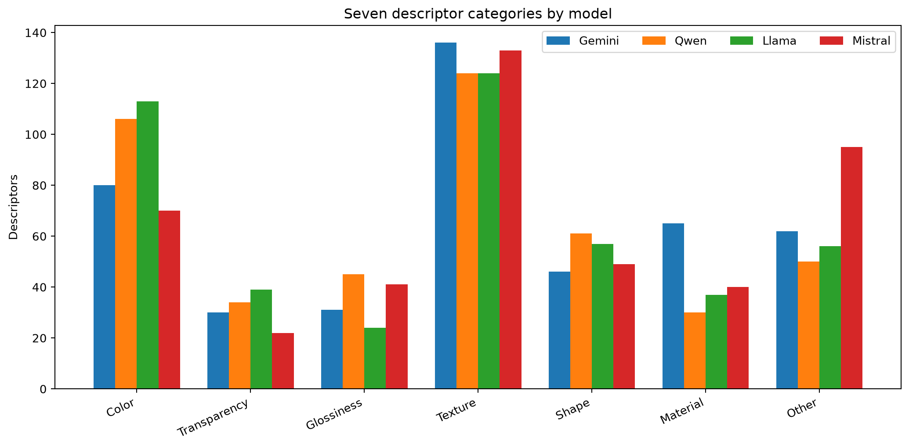
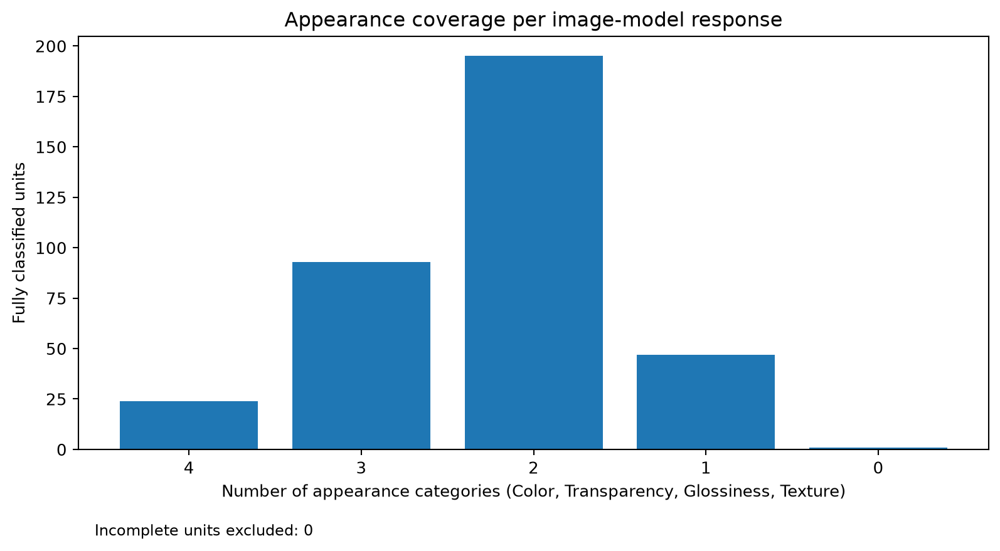

# Appearance AI — Material Appearance Description Analysis

A research workflow for comparing **four vision-language models (VLMs)** on natural material and surface images, followed by **human-supervised categorization** of the resulting appearance descriptors.

The research includes a **75-image pilot** and a **90-image study**. The local analysis app in this repository operates on the **90-image study only**.

## Overview

| Item | 90-image study |
| --- | --- |
| Images | 90 |
| Models | Gemini, Qwen, Llama, Mistral |
| Responses | 360 (90 images × 4 models) |
| Descriptors | 1,800 (five per response) |
| Categories | Color, Transparency, Glossiness, Texture, Shape, Material, Other |
| Appearance coverage | Number of distinct categories among Color, Transparency, Glossiness and Texture in each response |

**Scope:** The analysis characterizes the words models use and which appearance categories they mention. It is **not** a benchmark of image-grounded descriptive accuracy or statistically demonstrated model superiority.

## Repository structure

```text
.
├── README.md                 # English overview and setup
├── README_FA.md              # Detailed Persian usage guide
├── .gitignore
├── requirements.txt          # Local Python analysis dependencies
├── main.py                   # Local command-line interface
├── app.py                    # Streamlit labeling interface
├── src/
│   ├── core.py               # Data loading, annotation, coverage
│   └── reports.py            # Excel, CSV, and chart exports
├── tests/
│   └── test_pipeline.py
├── notebooks/
│   └── Appearance_AI.ipynb   # Historical Colab acquisition workflow
├── figures/                  # Three selected aggregate figures
├── results/                  # Selected aggregate, non-raw summaries
└── dataset_2/
    ├── input/                # Local Excel and image archive (ignored)
    ├── database/             # Local SQLite decisions (ignored)
    └── output/               # Generated analyses (ignored)
```

## Run the local analysis

Prerequisites: Python 3.10+ and a local copy of the study inputs. These commands were designed for Windows PowerShell (see `README_FA.md` for detailed instructions):

```powershell
py -m venv .venv
.\.venv\Scripts\python.exe -m pip install -r requirements.txt
.\.venv\Scripts\python.exe -m unittest discover -s tests -v
```

Place the two input files in `dataset_2/input/`:

- `Appearance_Part2_90_FINAL.xlsx` — the original 1,800-descriptor workbook, with `Word_Level_1800` sheet.
- `images2.zip` — source images, used for visual inspection by the Streamlit app.

Then initialize, inspect, label and export:

```powershell
.\.venv\Scripts\python.exe main.py init
.\.venv\Scripts\python.exe main.py status
.\.venv\Scripts\python.exe -m streamlit run app.py
.\.venv\Scripts\python.exe main.py report
```

These local scripts **do not call external AI APIs**. The `main.py init` step requires the real workbook; it cannot recreate the responses from images.

## Colab notebook: model inference

[`notebooks/Appearance_AI.ipynb`](notebooks/Appearance_AI.ipynb) preserves the Colab experimental source cells, including the pilot and 90-image study, API access through **Google Gemini** and **Cloudflare Workers AI**, and dataset validation / resume steps.

**Reproducibility note:** This notebook documents the original session rather than a standalone, one-click pipeline. Several `%run` cells refer to Python batch scripts and files stored in the original Google Drive environment; those scripts are **not included** in the supplied archive and therefore are not part of this repository. You must supply those original scripts, Drive inputs and your own configured API credentials to rerun the complete inference stage. Notebook execution outputs were removed before publishing; source cells were preserved.

No API keys, `.venv`, original images, personal Google Drive contents, raw response logs, or local SQLite files are shipped here.

## Selected results

The published summaries below were taken from a completed local analysis export dated **2026-10-23 (UTC)**. They are retained as illustrative **aggregate** results; reproducing the original annotation decisions requires the original local SQLite database or equivalent labeling record, which is intentionally not committed.







Aggregate CSV and JSON outputs are available under [`results/`](results/).

## Data and publication notes

- Raw images, input workbook and human annotation database are excluded from public source control. Verify redistribution rights for any externally sourced images before sharing them separately.
- Never upload Colab Secrets, Cloudflare tokens, Google API keys, local `.env` files or unreviewed notebook outputs.
- The charts and metrics represent **descriptor use and category coverage**, not accuracy against human visual judgments.
- This repository contains **no license grant** for the code or third-party datasets; add a license explicitly if public reuse is intended.

For step-by-step instructions in Persian, see [`README_FA.md`](README_FA.md).
